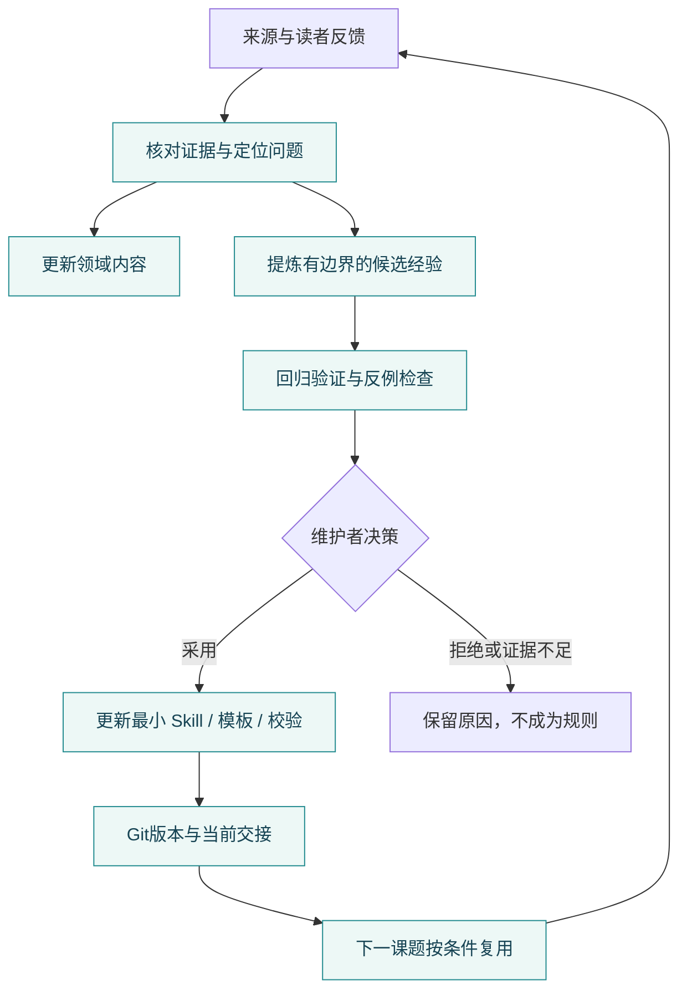

# CCN 可复用洞察与维护经验

维护能力随Git仓库保留，不依赖上一段聊天。参照model-tuning-lab的经验入仓、窄skill治理和交接分工，重新实现适合洞察网站的轻量机制，未复制其模型实验/远端主机规则。参考依据见[进化说明](../.agents/skills/ccn-experience-evolve/references/evolution.md)。

## 三种知识各归其位

| 内容 | 唯一维护位置 | 作用 |
| --- | --- | --- |
| 领域事实与技术判断 | 现有压缩：data/compression/tables/；新领域：content/insights/ | 给读者使用的研究知识 |
| 可重复的方法 | .agents/skills/及注册表 | 告诉维护者遇到某类任务如何做 |
| 实践、反例与判定 | .agents/experience/、.agents/evals/ | 解释规则来源及验证范围 |
| 当前续跑状态 | .agents/HANDOFF.md | 让另一位维护者接续未完成工作 |



## 下次构筑极稳

先让维护者读取AGENTS、HANDOFF和注册表，按需调用 `$ccn-insight-build`、`$ccn-evidence-review`。不要求所有工具支持相同的自动发现方式：能发现仓库级skill的工具直接使用，否则明确读取相应SKILL.md；不用复制一份到全局目录。

可从以下命令开始：

```text
python scripts/insight_topic.py new --domain wen --slug fault-recovery --title "极稳 · 故障恢复" --question "不同故障与负载下，哪些机制缩短恢复且保持正确性？"
python scripts/insight_topic.py validate content/insights/wen/fault-recovery/topic.json
python scripts/insight_topic.py render content/insights/wen/fault-recovery/topic.json --out dist/drafts/wen/fault-recovery.html
```

它生成内容草稿和隔离预览，不会把推理压缩论文带入极稳，也不接入公开导航。补充挑战、路线、一手来源、条件完整的主张及改变判断的条件后，再接入现有站点组件。测试、评价、经验与交接可以复用；领域机制和事实必须重新研究。

## 进化实际如何发生

1. 一次真实任务暴露问题，记录触发条件、下一次要改变的行为、适用范围、反例和证据；先找已有skill，避免堆出几十个重叠入口。
2. 建立proposed经验，用固定校验白名单验证。回执绑定经验、证据、目标资产、校验器及日志的哈希。旧回执无法证明改过的规则。
3. 真实维护者给出采用或拒绝的决策，再记录accepted/rejected。工具不代替维护者身份认证；决策JSON是审计材料，团队审批可结合PR审阅。
4. 采用后修改最小资产并重新验证，更新交接与Git版本。网站发布单独执行，不能因为skill通过就自动发布内容。

已提供三条来自本轮实际问题的候选：引用定位归属、指标口径、浏览器请求与实际状态。它们有证据和回归入口，状态仍为proposed；不伪造维护者已批准未来规则。

当前自动化包括脚手架、契约反例测试、经验校验和验证回执；GitHub工作流加入这些检查，但尚未推送触发云端CI。没有配置定时抓取，也没有系统自行重写skill的后台服务。

## 验收范围

运行 `python scripts/validate_insight_skills.py`、`python scripts/test_insight_workbench.py`、`python scripts/insight_learning.py validate`。再按改动运行页面和内容检查。结构通过只证明结构，网页事实和用户体验仍需核对原文及浏览器。
